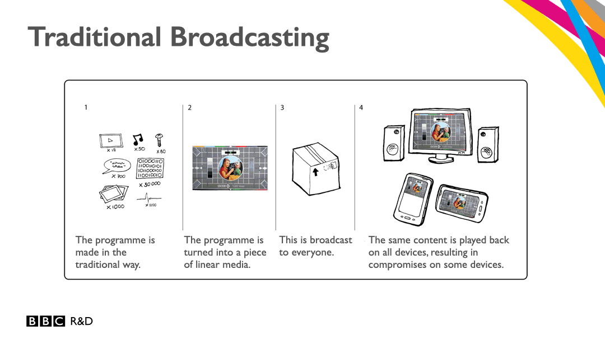
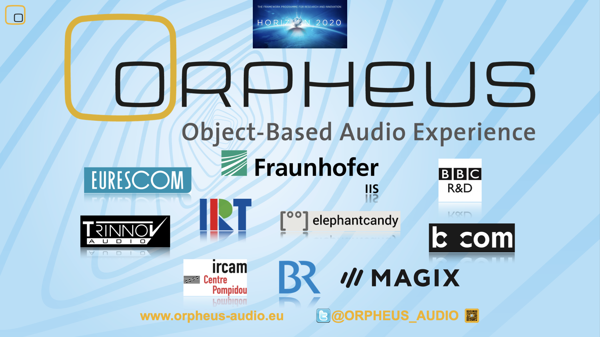
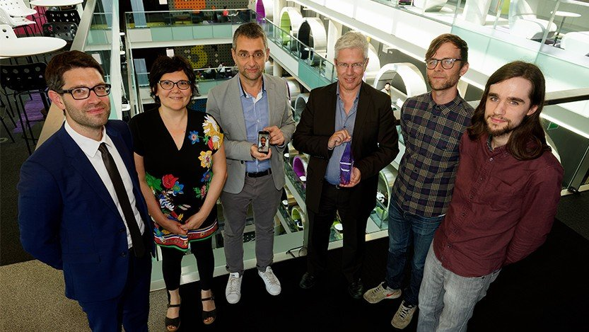
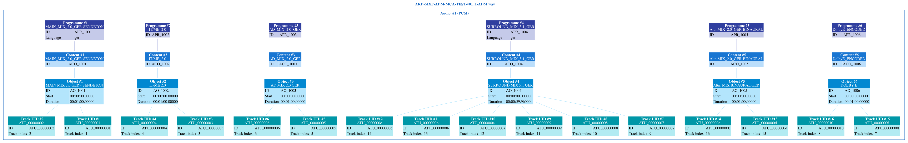
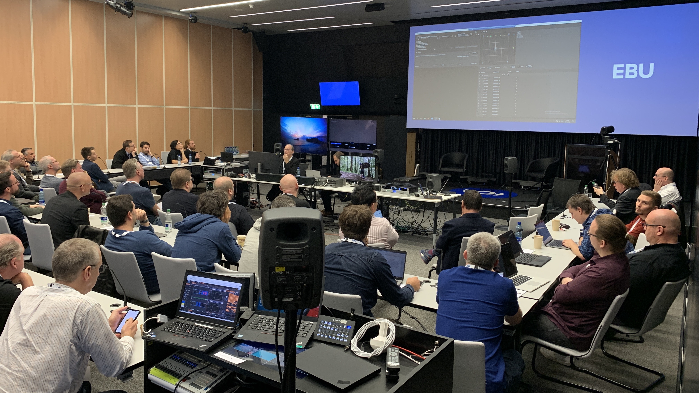

# **ADM** MILESTONES

ADM was conceptualised 2010
by developers at BBC R&D as it became clear that future audio will not just go beyond conventional 2.0 and 5.1 representations, but demands regarding speech intelligibility and accessibility will require more flexible and intelligent approaches from production to delivery.

The idea was to address these challenges with an "object-based" approach, i.e. by accompanying metadata that can control a renderer while offering the listeners interactivity for personalisation. This was one of the first visualistions of the concept.

.....

Here the milestones of **ADM**

* 2015: [ITU-R BS. 2076-0](https://www.itu.int/rec/R-REC-BS.2076-0-201506-S/en) was first published in 6 languages. This recommendation by the ITU Radiocommunications Assemby marks the birth of ADM in the public. It corresponds to [ITU-R BS.2015: Advanced sound system for programme production](https://www.itu.int/rec/R-REC-BS.2051-0-201402-S/en) that, for the first time, outlined the scope of future audio systems for digital broadcasting and digital cinema.

*  Dec 1 2015 - May 31 2018: [ORPHEUS](https://orpheus-audio.eu)      
    

The EU-funded *HORIZON 2020* project assembles major audio research institutes and industry partners, with the aim to design and implement the first end-to-end object-based audio broadcast chain.   ADM is one of the core technologies included - and a main components for ADM, can be developed: [libadm], [libbw64] and [EAR - The EBU ADM Renderer](https://github.com/ebu/ebu_adm_renderer), which will become the reference implementation of [Audio Definition Model renderer for advanced sound systems ITU-R BS.2127](https://www.itu.int/rec/R-REC-BS.2127/en).    
In 2018, *BBC R&D*, *IRT*, *FTV* and *b>com* receive the [*EBU Technology & Innovation Award*](https://www.ebu.ch/news/2018/06/renderer-for-next-generation-audio-wins-2018-ebu-technology--innovation-award?_gl=1*1f7car6*_ga*OTcwNjM3MzM2LjE0NDY0NTcwMDI.*_ga_TVTB816MPW*czE3OTIxNDQyMjIkbzI4NiRnMCR0MTc5MjE0NDIyOCRqNTQkbDAkaDA.) for this joint effort.

With *Fraunhofer IIS* in the ORPHEUS consortium, a driver behind *MPEG-H*, both ecosystems get closely related in structure and functionalities, with ADM being implemented as metadata authoring option.    

* 2017: ITU-R BS.2076-1 published containing major extensions to the model, regarded as first official version and leading towards the ...
* 2018: [ADM Production Profile V1 EBU TECH 3392](https://tech.ebu.ch/publications/tech3392)

* 2019: [Dolby Atmos Master ADMd Profile V1.0](https://developer.dolby.com/globalassets/documentation/technology/dolby_atmos_master_adm_profile_v1.0.pdf) - the first commercial implementation of ADM, based upon *BS.2076-0*. Alongside, with Dolby Atmos authoring tools, ADM becomes an alternative mastering format to Dolby's proprietary *DAMF*.  ADM will prevail.

* 2019: ITU-R BS.2076-2 published. It forms the basis also for the ...
* 2020: [MPEG-H Production Profile v1.0](https://mpegh.com/wp-content/uploads/2026/10/MPEG_H_ADM_Profile.pdf) that incorporates object-based key features of ADM such as adaptive dialogue levels etc.  

* 2021: [EAR Production Suite](https://ear-production-suite.ebu.io) published. A paradigmatic implementation of ADMv2 for [REAPER](https://www.reaper.fm/) DAW

* 2021: [IRT](https://en.wikipedia.org/wiki/Institut_für_Rundfunktechnik) dissolved. After 65 years, PSB shareholders ARD, ZDF, ORF and SRG decided to close down their prestigious R&D institution. Audio staff of the IRT was very much involved in and dedicated to ADM's development. Their departure leaves a huge gap in ongoing efforts. IRT's tech blog has been -[preserved here](https://lab.fktg.org) You'll find interesting posts on ADM development, too.

* 2021: UHD-Recommendation EBU [R153](https://tech.ebu.ch/docs/r/r153.pdf)/[R154](https://tech.ebu.ch/docs/r/r154.pdf) proposes ADM for more efficient handling  replacing conventional track layouts

* 2021: [MediaInfo](https://mediaarea.net/en/MediaInfo) implements ADM (sponsored by EBU). Meanwhile MediaInfo and related apps have become essential to parse and visualise ADM metadata.

* 2022: EBU's three day [PERSONALISED SOUND EXPERIENCE WORKFLOWS](https://tech.ebu.ch/events/2022/personalized-sound-experiences-workflows) workshop brings together, for the first time, pioneering vendors and broadcasters to present and demo the various aspects and opportunities for ADM in practice. Participants form the nucleus of what is to become ADM-IG.    

* 2024: Google/Samsung ECLIPSA/[IAMF](https://github.com/AOMediaCodec/iamf) adapts ADM as basis for their own eco-system.

* 2025: ADM [Emission Profile ITU-R. BS2168-0](https://www.itu.int/dms_pubrec/itu-r/rec/bs/R-REC-BS.2168-0-202502-I!!PDF-E.pdf) defines NGA interoperability points for NGA codecs like AC-4 und MPEG-H

*  2025 [ADM Production Profile V2 EBU TECH 3393](https://tech.ebu.ch/files/live/sites/tech/files/shared/tech/tech3393.pdf)
 ADM Implementers Group (ADM* IG) launched

* 2026: ADM-IG presents [*ADM STUDIO*](../tech/ADM_studio.md), a ST 2110-based AV production- and playout set-up;     
 1st  und 2nd ADM-Plugfest; ADM implementations shown at [IBC](../admig/ibc2026.md), ITU, MXF-Plugfest...

* to be continued...
