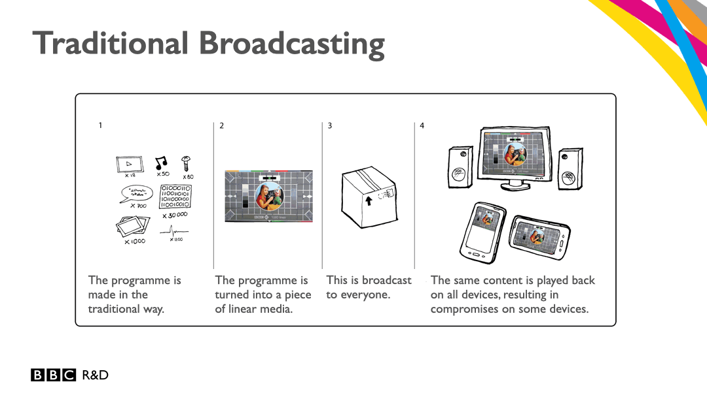
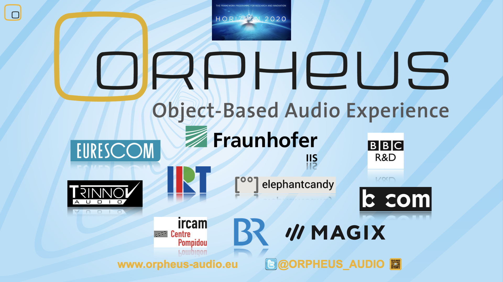
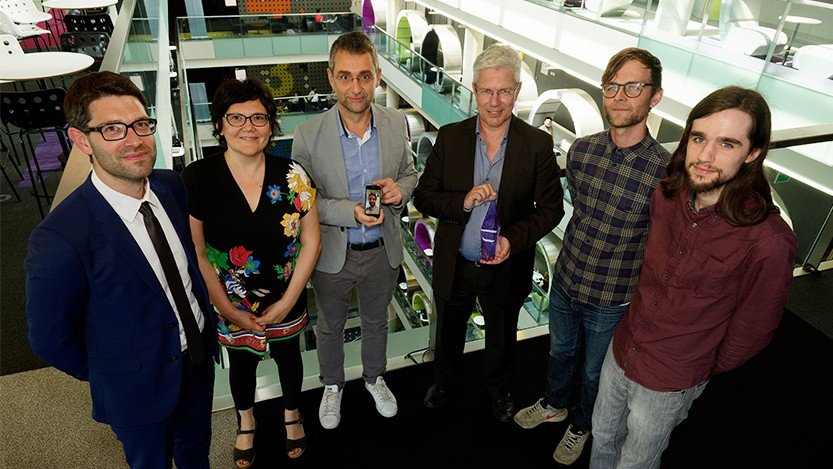

# A Timeline of **ADM**

ADM was conceptualised (around) 201x by developers at BBC R&D as it became clear that future audio will not just go beyond conventional 2.0 and 5.1 representations, but demands regarding speech intelligibility and accessibility will require more flexible and intelligent approaches from production to delivery.

The idea was to address these challenges with an "object-based" approach, i.e. by accompanying metadata that can control a renderer while offering the listeners interactivity for personalisation. This was one of the first visualistions of the concept.

.....

Here some milestones of the developmemt

- 2015: [ITU-R BS. 2076-0](https://www.itu.int/rec/R-REC-BS.2076-0-201506-S/en) was first published in 6 languages. This recommendation by the ITU Radiocommunications Assemby marks the birth of ADM in the public. It corresponds to [ITU-R BS.2015: Advanced sound system for programme production](https://www.itu.int/rec/R-REC-BS.2051-0-201402-S/en) that, for the first time, outlined the scope of future audio systems for digital broadcasting and digital cinema.

-  Dec 1 2015 - May 31 2018: [ORPHEUS](https://orpheus-audio.eu)      

The EU-funded *HORIZON 2020* project assembles major audio research institutes and industry partners, with the aim to design and implement the first end-to-end object-based audio broadcast chain.   ADM is one of the core technologies included - and a main components for ADM, can be developed: [libadm], [libbw64] and [EAR - The EBU ADM Renderer](https://github.com/ebu/ebu_adm_renderer), which will become the reference implementation of [Audio Definition Model renderer for advanced sound systems ITU-R BS.2127](https://www.itu.int/rec/R-REC-BS.2127/en).    
In 2018, *BBC R&D*, *IRT*, *FTV* and *b>com* receive the [*EBU Technology & Innovation Award*](https://www.ebu.ch/news/2018/06/renderer-for-next-generation-audio-wins-2018-ebu-technology--innovation-award?_gl=1*1f7car6*_ga*OTcwNjM3MzM2LjE0NDY0NTcwMDI.*_ga_TVTB816MPW*czE3OTIxNDQyMjIkbzI4NiRnMCR0MTc5MjE0NDIyOCRqNTQkbDAkaDA.) for this joint effort.

With *Fraunhofer IIS* in the ORPHEUS consortium, a driver behind *MPEG-H*, both ecosystems get closely related in structure and functionalities, with ADM being implemented as metadata authoring option.

- 2019: Dolby publishes the [Dolby Atmos Master ADMd Profile V1.0](https://developer.dolby.com/globalassets/documentation/technology/dolby_atmos_master_adm_profile_v1.0.pdf) - the first commercial implementation of ADM. Alongside, with Dolby Atmos authoring being present in major DAWs, ADM is introduced as alternative mastering format to Dolby's proprietary *DAMF*.  ADM will prevail.

- ...
