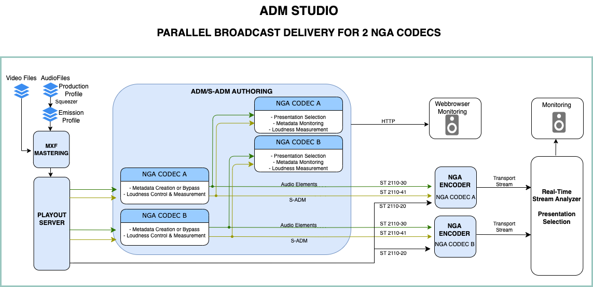
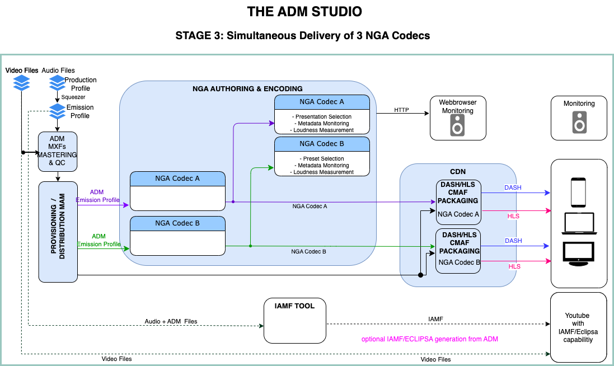

# ADM*2*NGA - The *Step 3*    

In a final step, when distribution channels implement *NGA* codecs and compatible devices or applications are available, ADM-based productions will offer all benefits of 'object-based' audio in full extent to the audience.

Converting an [ADM EBU Tech 3393 Production Profile](https://tech.ebu.ch/publications/tech3393) production according to the [AdvSS (ADM) Emission Profile ITU-R BS.2168](https://www.itu.int/rec/R-REC-BS.2168/en) is the way to go.

These [**STEP 3**](migration.md) workflows shows the possibilities

### A. On-Air Broadcasting###

### B. On-Demand Streaming###

